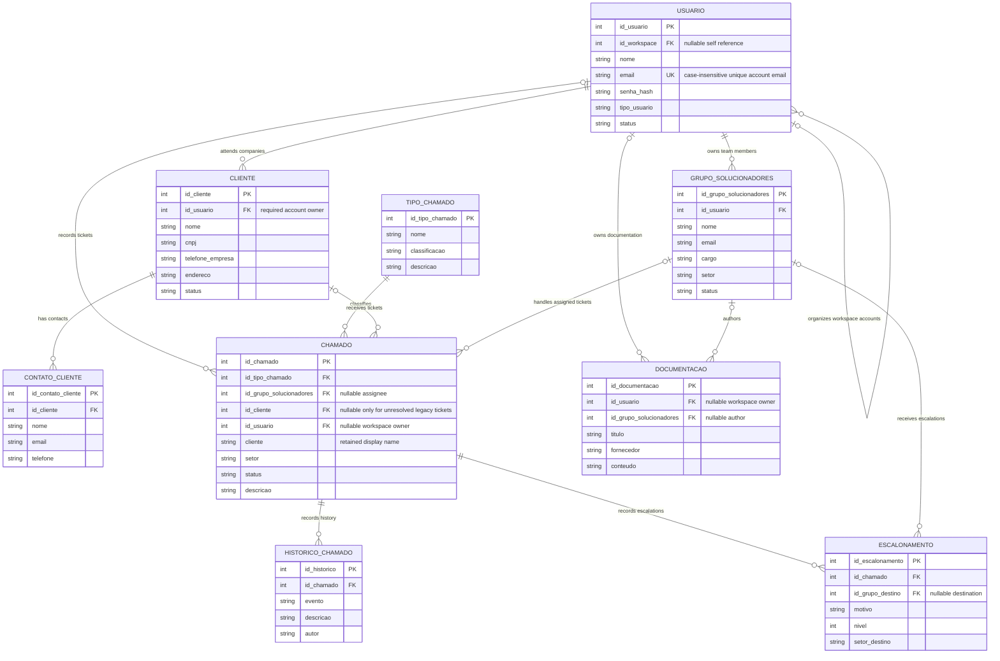

# Data Architecture & Persistence Layer

O HelpTI usa um banco SQLite com nove tabelas relacionais e SQL executado diretamente pela aplicação, sem ORM. `backend/schema.sql` é a fonte do schema e `backend/database.py` executa inicialização, versionamento e migrações compatíveis.

## Database Configuration

| Service/Module | DB Type | Profile | Driver | Connection | Migration Tool |
| --- | --- | --- | --- | --- | --- |
| Flask application | SQLite | All environments | Python `sqlite3` standard library | Local SQLite file or configured persistent file path | Application-managed SQL schema and versioned startup migrations; no external migration tool |

O banco não usa servidor separado nem pool externo. A aplicação executa o schema inicial e usa `PRAGMA user_version` com migrações implementadas no próprio módulo de banco. O modo de demonstração insere os tipos de chamado e a conta de teste por SQL de seed.

## Data Ownership per Service

| Service | Tables Owned | ORM Framework | Caching | Notes |
| --- | --- | --- | --- | --- |
| Flask application and SQLite database | `usuario`, `cliente`, `contato_cliente`, `tipo_chamado`, `grupo_solucionadores`, `chamado`, `historico_chamado`, `escalonamento`, `documentacao` | None; direct SQL through a small `sqlite3` connection wrapper | None identified | One SQLite database; accounts/workspaces own customer companies through `cliente.id_usuario` |

## Entity Model

The schema is defined in `backend/schema.sql`; data access and explicit transaction commits/rollbacks are in `backend/app.py`. `usuario` stores accounts/workspaces, `cliente` stores customer companies, and `contato_cliente` stores their contacts. The owner relationship is 1:N through `cliente.id_usuario`; the customer table has no `id_workspace` column. New tickets require a customer ID owned by the active workspace, while `chamado.cliente` remains a display snapshot.

<!-- mermaid-checked: every attribute is `<type> <name> [<key>] ["<description>"]` with at most one of PK/FK/UK, no \n in descriptions, no {} in descriptions, every relationship label is double-quoted -->

There is no 1:1 relationship enforced by the current schema. `CHAMADO` and `GRUPO_SOLUCIONADORES` have a logical N:N relationship over time through `ESCALONAMENTO`: a ticket can have multiple escalation records and a team member can be a destination in multiple records. The intermediary table also stores the reason, level, sector text and date. It is not a direct N:N foreign key.

`setor` is stored as text in `grupo_solucionadores` and `chamado`; the transfer destination is text in `escalonamento.setor_destino`. No `setor` table exists. `chamado.id_cliente` references the selected company; the snapshot name and requester/contact details are retained for display and historical continuity.

## Key Repository Methods

The project has no repository classes. Database reads and writes are SQL statements inside application functions.

| Service | Repository | Notable Methods | Purpose |
| --- | --- | --- | --- |
| Flask application | `backend/app.py` | `get_equipe()` | Lists team rows filtered to the current workspace |
| Flask application | `backend/app.py` | `get_setores()` | Reads distinct non-empty sector text values from team rows |
| Flask application | `backend/app.py` | `get_clientes()`, `create_cliente()`, `update_cliente()` | Reads and updates companies and their primary/secondary contact records |
| Flask application | `backend/app.py` | `create_equipe()` | Creates a team member as a workspace-owned record |
| Flask application | `backend/app.py` | `create_chamado()` | Validates `id_cliente` within the active workspace before inserting a ticket |

## Caching Strategy

No application-level or database query cache was identified. SQLite reads use direct SQL; the application does not configure a second-level ORM cache or an external cache provider.

## Data Ownership Boundaries

All nine tables are held in one SQLite file owned by the Flask application. Workspace isolation is implemented by filtering rows using ownership fields. The API validates that a ticket's `id_cliente` belongs to the active workspace. Historical tickets that cannot be mapped unambiguously remain with a null customer FK and preserve their prior display name.

### Data Classification & Sensitivity

| Entity | Sensitive Fields | Classification | Controls in Place |
| --- | --- | --- | --- |
| `usuario` | Name, email and password hash | PII and authentication data | Password is stored as a hash and account email is unique; no field-level encryption or masking is defined in the schema |
| `cliente` | Company name, CNPJ, address and business phone | Business identifiers and contact data | Workspace-level application filtering; no field-level encryption or masking is defined in the schema |
| `contato_cliente` | Contact name, email and phone | PII | Workspace scoping follows the parent company; no field-level encryption or masking is defined in the schema |
| `grupo_solucionadores` | Employee name, email and phone | PII | Workspace-level application filtering; no field-level encryption or masking is defined in the schema |
| `chamado` | Requester name, email, phone and free-text description | PII | Workspace-level application filtering; no field-level encryption or masking is defined in the schema |
| `historico_chamado` | Event author and free-text description | Potential PII | Stored with the related ticket; no field-level encryption or masking is defined in the schema |
| `documentacao` | Free-text technical content | Potentially sensitive operational data | Workspace-level application filtering; no field-level encryption or masking is defined in the schema |
| `tipo_chamado`, `escalonamento` | No explicit PII columns; text fields may contain user-provided details | Operational data, potentially PII in free text | No field-level encryption or masking is defined in the schema |

No dedicated PHI or PCI fields were identified in the SQLite schema. Free-text fields can still contain sensitive information entered by users.
