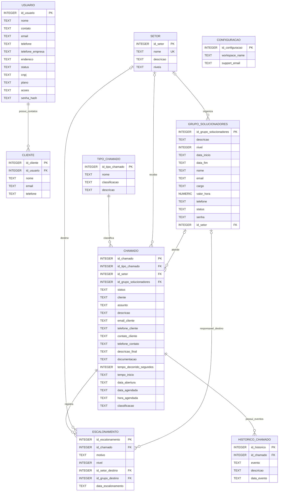

# HelpTI

Sistema web de gestão operacional para suporte técnico, com foco em acompanhar chamados, clientes, equipe e indicadores do atendimento de TI.

## Visão geral

O HelpTI é uma aplicação web para gestão de suporte técnico. O frontend usa HTML, CSS e JavaScript; o backend usa Flask e expõe uma API REST. Os dados são persistidos em SQLite, criado automaticamente na primeira inicialização.

O projeto reúne telas de login, dashboard, chamados, clientes, equipe, setores, relatórios, configurações, educação e planos. O Flask serve as páginas e a API no mesmo endereço.

---

## Estado atual do projeto

### Frontend
O frontend já conta com a estrutura principal do sistema em HTML, CSS e JavaScript.

- Tela de login com autenticação visual simulada
- Dashboard com indicadores de operação
- Agenda de chamados por dia e técnico
- Modal para abertura de novos chamados
- Dropdown de perfil com ações de configuração e logout
- Navegação entre páginas do painel

### Backend

- [backend/app.py](backend/app.py): aplicação Flask, páginas e endpoints da API
- [backend/database.py](backend/database.py): conexão SQLite e inicialização automática
- [backend/schema.sql](backend/schema.sql): tabelas, relacionamentos, índices e dados iniciais
- [backend/requirements.txt](backend/requirements.txt): dependências Python da aplicação

Chamados, clientes, contatos, equipe, setores e configurações permanecem salvos no banco local após reiniciar o servidor.

## Banco de dados

O banco padrão é SQLite. Na primeira inicialização, o sistema cria `instance/helpti.sqlite3` e aplica `backend/schema.sql`. Não é necessário instalar MySQL, usar Workbench ou configurar credenciais de banco no `.env`. Cada clone mantém seu próprio arquivo de dados, que não deve ser enviado ao Git.

### Tabelas e atributos

Os tipos abaixo são os tipos lógicos do SQLite: `INTEGER`, `TEXT` e `NUMERIC`.

| Tabela | Atributos |
| --- | --- |
| `usuario` | `id_usuario INTEGER` (PK); `nome`, `contato`, `email`, `telefone`, `telefone_empresa`, `endereco`, `cnpj`, `plano`, `acoes`, `senha_hash TEXT`; `status TEXT NOT NULL DEFAULT 'ATIVO'`. Representa a empresa cliente. |
| `cliente` | `id_cliente INTEGER` (PK); `id_usuario INTEGER NOT NULL` (FK); `nome`, `email`, `telefone TEXT NOT NULL`. Contatos associados a uma empresa. |
| `tipo_chamado` | `id_tipo_chamado INTEGER` (PK); `nome TEXT NOT NULL`; `classificacao`, `descricao TEXT`. Os tipos iniciais são Suporte Geral, Hardware, Software e Rede. |
| `setor` | `id_setor INTEGER` (PK); `nome TEXT NOT NULL UNIQUE`; `descricao TEXT`; `niveis TEXT` (JSON). |
| `grupo_solucionadores` | `id_grupo_solucionadores INTEGER` (PK); `descricao`, `nome`, `email`, `cargo`, `telefone TEXT`; `nivel INTEGER`; `data_inicio`, `data_fim TEXT`; `valor_hora NUMERIC`; `status TEXT NOT NULL DEFAULT 'ATIVO'`; `senha TEXT NOT NULL DEFAULT ''`; `id_setor INTEGER` (FK opcional). Apesar do nome legado, representa membros da equipe técnica e administradores. |
| `chamado` | `id_chamado INTEGER` (PK); `id_tipo_chamado INTEGER NOT NULL` (FK); `id_setor`, `id_grupo_solucionadores INTEGER` (FKs opcionais); `status TEXT NOT NULL DEFAULT 'ABERTO'`; `cliente TEXT NOT NULL`; `assunto`, `descricao`, `email_cliente`, `telefone_cliente`, `contato_cliente`, `telefone_contato`, `descricao_final`, `documentacao`, `tempo_inicio`, `data_agendada`, `hora_agendada`, `classificacao TEXT`; `tempo_decorrido_segundos INTEGER NOT NULL DEFAULT 0`; `data_abertura TEXT NOT NULL` (data/hora local). |
| `escalonamento` | `id_escalonamento INTEGER` (PK); `id_chamado INTEGER NOT NULL` (FK); `motivo TEXT`; `nivel INTEGER`; `id_setor_destino`, `id_grupo_destino INTEGER` (FKs opcionais); `data_escalonamento TEXT`. |
| `historico_chamado` | `id_historico INTEGER` (PK); `id_chamado INTEGER NOT NULL` (FK); `evento`, `descricao`, `data_evento TEXT NOT NULL`. Mantém a timeline de abertura, início, pausa, escalonamento, encerramento e alterações. |
| `configuracao` | `id_configuracao INTEGER` (PK); `workspace_name`, `support_email TEXT NOT NULL`. Guarda as configurações gerais do workspace. |

### Diagrama entidade-relacionamento



### Relacionamentos

- `usuario` 1:N `cliente`; excluir uma empresa exclui seus contatos.
- `tipo_chamado` 1:N `chamado`.
- `setor` 1:N `grupo_solucionadores` e `chamado`; ao excluir um setor, a referência é removida dos registros relacionados.
- `grupo_solucionadores` 1:N `chamado`; o vínculo fica nulo quando o membro é removido.
- `chamado` 1:N `escalonamento`; excluir o chamado exclui seu histórico de escalonamentos.
- `chamado` 1:N `historico_chamado`; excluir o chamado exclui seus eventos da timeline.
- `setor` e `grupo_solucionadores` também podem ser o destino de vários escalonamentos.
- `chamado` guarda os dados de cliente como texto e **não possui FK para `usuario`**; alterar o cadastro da empresa não altera chamados antigos.
- `configuracao` é independente das demais tabelas.

As chaves estrangeiras são habilitadas em cada conexão. O schema cria índices para contatos por empresa, equipe por setor, chamados por status/data e escalonamentos por chamado.

Ao migrar uma base antiga, a tabela `cliente_contato` é renomeada para `cliente` mantendo os registros. A antiga tabela `documentacao`, cujas linhas não apontavam para chamados, é arquivada como `documentacao_legado` (ou com sufixo numérico) se contiver dados; em instalações novas ela não é criada. O histórico inicial dos chamados existentes é preenchido usando `data_abertura`.

## API

Todos os endpoints usam o prefixo `/api` e são servidos pelo mesmo processo Flask.

| Recurso | Endpoints |
| --- | --- |
| Saúde | `GET /api/health` |
| Chamados | `GET/POST /api/chamados`, `GET/PUT/DELETE /api/chamados/<id>` |
| Clientes | `GET/POST /api/clientes`, `PUT/DELETE /api/clientes/<id>` |
| Equipe | `GET/POST /api/equipe`, `PUT/DELETE /api/equipe/<id>` |
| Setores | `GET/POST /api/setores`, `DELETE /api/setores/<id>` |
| Contas e sessão | `POST /api/contas`, `POST /api/login` |
| Relatórios | `GET /api/relatorios?periodo=todos|mes|dia` |
| Configurações | `GET/PUT /api/configuracoes` |

### Persistência e compartilhamento

O banco é local a cada computador: clonar ou atualizar o repositório não compartilha registros entre integrantes. Para backup local, pare o servidor e copie `instance/helpti.sqlite3`. Para uma base realmente compartilhada entre usuários, será necessário hospedar um banco central (por exemplo, PostgreSQL ou MySQL) e configurar o acesso seguro à rede; não coloque o arquivo SQLite no Git como mecanismo de sincronização.

---

## Estrutura do projeto

```text
HelpTI/
├── README.md
├── backend/
│   ├── app.py
│   ├── database.py
│   └── schema.sql
├── frontend/
│   ├── assets/
│   │   ├── css/
│   │   │   ├── dashboard.css
│   │   │   ├── login.css
│   │   │   ├── planos.css
│   │   │   └── variables.css
│   │   ├── images/
│   │   └── js/
│   │       ├── api.js
│   │       ├── dashboard.js
│   │       └── main.js
│   ├── pages/
│   │   ├── chamados.html
│   │   ├── clientes.html
│   │   ├── dashboard.html
│   │   ├── equipe.html
│   │   ├── login.html
│   │   └── relatorios.html
│   └── planos.html
└── .gitignore
```

---

## Páginas existentes

### Login
Página inicial de acesso ao sistema.

- [frontend/pages/login.html](frontend/pages/login.html)

### Dashboard
Painel principal com visão geral operacional e fila de atendimentos.

- [frontend/pages/dashboard.html](frontend/pages/dashboard.html)

### Chamados
Estrutura para gestão e acompanhamento de chamados.

- [frontend/pages/chamados.html](frontend/pages/chamados.html)

### Clientes
Área para cadastro e organização de clientes e contratos.

- [frontend/pages/clientes.html](frontend/pages/clientes.html)

### Equipe
Visualização da equipe técnica e estrutura departamental.

- [frontend/pages/equipe.html](frontend/pages/equipe.html)

### Relatórios
Módulo para indicadores e relatórios futuros.

- [frontend/pages/relatorios.html](frontend/pages/relatorios.html)

---

## Arquivos principais

### CSS
- [frontend/assets/css/dashboard.css](frontend/assets/css/dashboard.css): layout e estilos do dashboard
- [frontend/assets/css/login.css](frontend/assets/css/login.css): estilos da tela de login
- [frontend/assets/css/variables.css](frontend/assets/css/variables.css): paleta de cores e variáveis globais
- [frontend/assets/css/planos.css](frontend/assets/css/planos.css): estilos de planos e contratos

### JavaScript
- [frontend/assets/js/dashboard.js](frontend/assets/js/dashboard.js): agenda, criação e atualização de chamados
- [frontend/assets/js/api.js](frontend/assets/js/api.js): funções de comunicação com a API
- [frontend/assets/js/main.js](frontend/assets/js/main.js): modais, cadastros e telas de detalhe

---

## Como executar

O projeto roda com um único processo. O Flask serve as páginas do frontend, disponibiliza a API e abre o navegador automaticamente.

### Primeira configuração

1. Instale Python 3.8 ou superior.
2. Clone ou copie o projeto para o computador.
3. Abra o projeto no VS Code e abra um terminal na raiz da pasta `HelpTI`.
4. Crie e ative um ambiente virtual:

```powershell
python -m venv .venv
.\.venv\Scripts\Activate.ps1
```

5. Instale as dependências:

```powershell
python -m pip install -r backend\requirements.txt
```

6. Não é necessário criar o banco nem configurar `DB_*` no `.env`. O SQLite e as tabelas são inicializados automaticamente.

O arquivo `backend/.env` é opcional e pode conter configurações `SMTP_*` para enviar e-mails quando um chamado for resolvido. Sem SMTP, os demais fluxos da aplicação continuam disponíveis, mas o encerramento com envio de e-mail retorna uma mensagem de configuração necessária. Nunca envie credenciais ao Git.

### Iniciar o projeto

Com as dependências instaladas e o ambiente virtual ativado, execute na pasta raiz `HelpTI`:

```powershell
python app.py
```

O arquivo [app.py](app.py) na raiz inicializa o banco local se necessário e inicia a API e o frontend. O navegador abrirá em `http://127.0.0.1:5000/`. O arquivo SQLite fica em `instance/helpti.sqlite3` e é ignorado pelo Git.

Endereços úteis:

- Aplicação: `http://127.0.0.1:5000/`
- Login direto: `http://127.0.0.1:5000/frontend/pages/login.html`
- Teste da API: `http://127.0.0.1:5000/api/health`
- Educação: `http://127.0.0.1:5000/frontend/pages/educacao.html`

Não é necessário executar `python -m http.server` nem abrir a porta 8000.

### Encerrar

No terminal em que o Flask está rodando, pressione `Ctrl+C`.

---

## Status do desenvolvimento

O projeto possui interface web, API Flask e persistência local em SQLite. A configuração e os dados iniciais são aplicados no primeiro start. SMTP é opcional e necessário somente para o envio de e-mails de resolução.

---

## Conclusão

Cada integrante trabalha com seu próprio banco SQLite local. Os dados não são enviados ao repositório nem sincronizados por `git pull`.

## Como contribuir

Antes de alterar o código, consulte [INTEGRACAO.md](INTEGRACAO.md) e a modelagem de dados acima. Faça mudanças pequenas, teste a API e o fluxo da tela correspondente e descreva no pull request o que foi alterado e como testar. Para dados locais, pare o servidor antes de copiar o arquivo de banco como backup.

---

