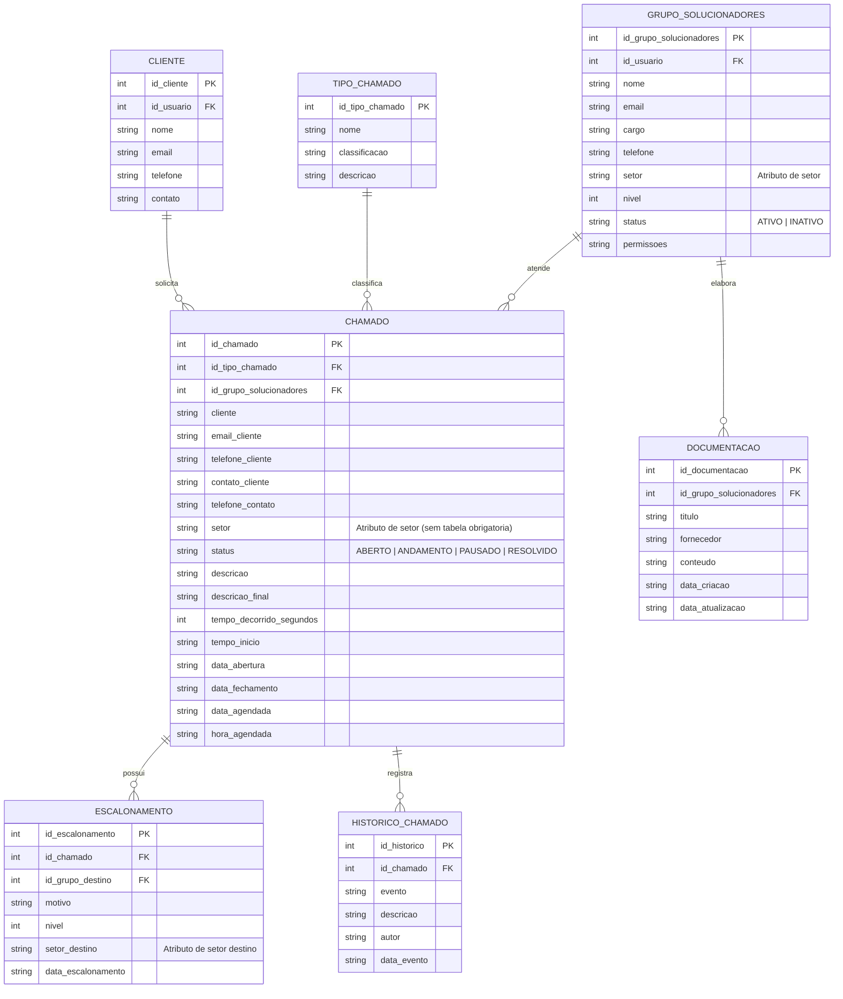

# HelpTI — Como Rodar o Projeto

Guia direto e prático para instalação, execução e testes do **HelpTI**.

> 📖 **Documentação Completa da Arquitetura e Modelagem:**
> Para consultar a documentação técnica integral — incluindo arquitetura de software, modelagem de banco de dados relacional (SQLite e Oracle), justificativa do atributo `setor`, regras de negócio do Projeto 3 (DeskOps), métricas operacionais (MTTR) e catálogo completo da API REST —, consulte o arquivo [DOCUMENTACAO_WRAPPER.md](DOCUMENTACAO_WRAPPER.md).

---

## 1. Pré-requisitos

Antes de iniciar, certifique-se de possuir em seu ambiente:
- **Python:** Versão 3.8 ou superior instalada ([python.org](https://www.python.org/downloads/)).
- **Git:** Instalado e configurado no terminal.
- **Navegador Web:** Qualquer navegador moderno (Google Chrome, Microsoft Edge, Mozilla Firefox).
- *(Opcional)* **Docker e Docker Compose:** Caso prefira executar o sistema em containers.

---

## 2. Como Rodar Localmente (Passo a Passo)

### 2.1. Clonar o Repositório
Abra o terminal ou PowerShell e execute:
```bash
git clone https://github.com/Carlos-Eduardo20/HelpTI.git
cd HelpTI
```

### 2.2. Criar e Ativar o Ambiente Virtual

**No Windows (PowerShell):**
```powershell
python -m venv .venv
.\.venv\Scripts\Activate.ps1
```

**No Linux ou macOS:**
```bash
python3 -m venv .venv
source .venv/bin/activate
```

### 2.3. Instalar as Dependências
Com o ambiente virtual ativado, instale os pacotes requeridos:
```bash
pip install -r backend/requirements.txt
```

### 2.4. Iniciar a Aplicação
Execute o arquivo principal na raiz do projeto:
```bash
python app.py
```
> O banco de dados local SQLite (`instance/helpti.sqlite3`) é criado e configurado automaticamente na primeira inicialização, aplicando as tabelas e migrações necessárias. Não é necessário criar tabelas manualmente.

---

## 3. Modos de Inicialização (Demonstração vs. Novo Workspace)

Ao executar `python app.py`, o sistema apresentará uma pergunta interativa no terminal:

```text
Deseja iniciar com a conta de teste HelpTI? [S/N]:
```

### Opção [S] — Modo de Teste / Demonstração (Recomendado)
- Responda **`S`** e pressione Enter.
- O sistema iniciará utilizando o banco de dados de demonstração (`instance/helpti.sqlite3`), pré-configurado com a conta administradora **HelpTI**, tipos de chamado e setor de suporte padrão.
- **Acesse no navegador:** [http://127.0.0.1:5000/](http://127.0.0.1:5000/)
- **Credenciais de Teste:**
  - **E-mail:** `test@helpiti.com`
  - **Senha:** `HelpTI2026!`

### Opção [N] — Novo Workspace / Empresa Própria
- Responda **`N`** e pressione Enter.
- O sistema iniciará com uma base limpa (`instance/helpti-empresa-local.sqlite3`) para criar a empresa e a conta administradora principal.
- **Acesse a tela de cadastro:** [http://127.0.0.1:5000/frontend/pages/account.html](http://127.0.0.1:5000/frontend/pages/account.html)

---

## 4. Como Executar com Docker e Docker Compose

Caso possua o Docker instalado e prefira executar em ambiente isolado de containers:

```bash
docker compose up --build
```

A aplicação será compilada e inicializada em: [http://localhost:5000](http://localhost:5000)

Para interromper a execução:
```bash
docker compose down
```

---

## 5. Como Executar no GitHub Codespaces

1. Acesse o repositório no GitHub.
2. Clique no botão verde **Code** → selecione a aba **Codespaces** → clique em **Create codespace on main**.
3. Aguarde o ambiente carregar e configurar o Dev Container.
4. No terminal integrado do Codespace, execute:
   ```bash
   python app.py
   ```
5. Responda **`S`** para inicializar o modo de demonstração.
6. Na aba **Ports** do VS Code, clique no ícone de globo/navegador ao lado da porta `5000`.

---

## 6. Como Rodar os Testes Automatizados

O sistema conta com uma suíte de testes unitários e de integração abrangente (verificação de rotas, integridade de dados, regras de negócio do Projeto 3/DeskOps e documentações técnicas).

Para rodar todos os testes automatizados do projeto:
```bash
python -m unittest discover -s backend/tests
```

---

## 7. Modelagem de Banco de Dados (ERD)

A modelagem de dados do **HelpTI** foi desenvolvida de forma enxuta e focada na simplicidade de um sistema de Service Desk / Helpdesk, mantendo apenas as entidades e atributos essenciais sem sobrecarga de tabelas:



### Entidades Essenciais e Relacionamentos
- **`cliente`**: Cadastro das empresas clientes e solicitantes do suporte.
- **`tipo_chamado`**: Classificação temática dos tipos de solicitação técnica.
- **`chamado`**: Entidade central de tickets do helpdesk com atributos de contato, histórico de tempo decorrido, data de agendamento (agenda) e status de atendimento (sem prioridade, assegurando abertura rápida).
- **`setor` (Atributo)**: Definido como atributo direto (`setor`) em `chamado` e `grupo_solucionadores`, eliminando a necessidade de tabelas desnecessárias no banco.
- **`grupo_solucionadores`**: Técnicos e atendentes da equipe técnica responsáveis pela resolução dos chamados.
- **`escalonamento`**: Rastreabilidade de transferências entre níveis e setores de suporte.
- **`documentacao`**: Base de conhecimento com artigos e procedimentos técnicos por fornecedor e equipe.
- **`historico_chamado`**: Linha do tempo auditável de cada evento do chamado com identificação do autor.


Para executar especificamente a suíte de testes do Projeto 3 (DeskOps):
```bash
python -m unittest backend/tests/test_deskops_project3.py
```

---

## 7. Principais URLs de Acesso

Com a aplicação em execução na porta `5000`:

| Funcionalidade / Módulo | URL no Navegador |
| --- | --- |
| **Painel de Chamados (DeskOps)** | `http://127.0.0.1:5000/frontend/pages/chamados.html` |
| **Dashboard Operacional** | `http://127.0.0.1:5000/frontend/pages/dashboard.html` |
| **Login do Sistema** | `http://127.0.0.1:5000/frontend/pages/login.html` |
| **Cadastro de Novo Administrador** | `http://127.0.0.1:5000/frontend/pages/account.html` |
| **Educação e Visualização 3D** | `http://127.0.0.1:5000/frontend/pages/educacao.html` |
| **Endpoint de Métricas DeskOps** | `http://127.0.0.1:5000/api/chamados/metricas` |
| **Verificação de Saúde da API** | `http://127.0.0.1:5000/api/health` |

---

## 8. Documentação Completa do Projeto

Para consultar o detalhamento completo de:
- Arquitetura de software e diagrama de componentes
- Modelagem de dados relacional (entidades, atributos, integridade referencial e scripts Oracle/SQLite)
- Justificativa técnica do atributo `setor` (sem tabela própria no modelo conceitual)
- Regras de negócio DeskOps (MTTR médio, SLA, permissões de cliente vs. técnico, autor no histórico)
- Catálogo exaustivo de endpoints da API REST

Consulte o arquivo principal: **[DOCUMENTACAO_WRAPPER.md](DOCUMENTACAO_WRAPPER.md)**.
