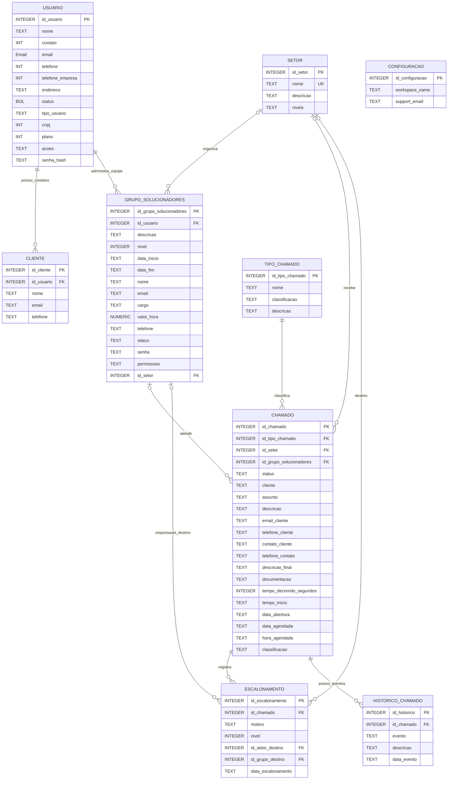

# HelpTI
## Visão geral

O HelpTI é uma aplicação web para gestão de suporte técnico. O frontend usa HTML, CSS e JavaScript; o backend usa Flask e expõe uma API REST. Os dados são persistidos em SQLite, criado automaticamente na primeira inicialização.

### Problema que motivou o projeto

Uma equipe de suporte interno de TI controlava seus chamados em planilhas compartilhadas e por e-mail. Com o aumento das solicitações, esse processo passou a causar problemas que também dificultavam organizar os dados e produzir relatórios confiáveis:

- **Histórico incompleto:** linhas eram apagadas ou sobrescritas, então não havia um registro confiável das alterações de status, dos responsáveis e das ações realizadas.
- **Dados inconsistentes e duplicados:** cada pessoa podia escrever status e nomes de clientes de formas diferentes, e não havia validação nem relacionamentos que impedissem referências incorretas.
- **Conflito de atendimento:** duas pessoas podiam assumir ou alterar o mesmo chamado sem perceber, causando retrabalho e informações divergentes.

O projeto foi criado para resolver esse problema com uma aplicação apoiada por um banco de dados relacional: clientes, contatos, chamados, responsáveis e histórico ficam organizados em tabelas relacionadas, com valores padronizados e alterações registradas. Isso permite consultar os atendimentos e demonstrar como a modelagem e as restrições do banco ajudam a manter os dados consistentes.

O projeto reúne telas de login, dashboard, chamados, clientes, equipe, setores, relatórios, configurações, educação e planos. O Flask serve as páginas e a API no mesmo endereço.

A visualização interativa de componentes 3D da página Educação é desenhada em Python pelo Flask. Para iniciar o sistema e acessar a visualização, execute `python app.py` na raiz do projeto; não é necessário iniciar um aplicativo Tkinter separado.

---

## Banco de dados

O banco padrão é SQLite local. Na primeira inicialização, o sistema cria `instance/helpti.sqlite3` e aplica `backend/schema.sql` e `backend/demo_seed.sql`. O banco de cada pessoa ou Codespace permanece independente e não é enviado ao Git.

Ao executar `python app.py`, o terminal pergunta se deve iniciar com a conta de teste HelpTI. Respondendo `S`, a instalação cria/usa seu banco de demonstração, com a conta administradora **HelpTI** e um setor vazio chamado **Suporte** associado a ela. Não são criados chamados, clientes ou contatos. O login é `test@helpiti.com` / `HelpTI2026!`; essa senha é pública e serve apenas para testes. Tipos de chamado são mantidos porque são opções de referência necessárias ao sistema.

Respondendo `N`, o app inicia outra base vazia, separada da demonstração, para criar a empresa e o primeiro administrador. Cada clone e cada Codespace guardam seu SQLite dentro da própria cópia e não sincronizam dados com outras máquinas. A conta de teste existe em cada instalação escolhida, mas chamados criados no clone de um amigo só ficam no banco daquele clone. Não use a conta de teste com dados reais nem exponha uma instalação pública com a demonstração ativa.

### Tabelas e atributos

| Tabela | Atributos |
| --- | --- |
| `usuario` | `id_usuario INTEGER` (PK); `nome`, `contato`, `email`, `telefone`, `telefone_empresa`, `endereco`, `cnpj`, `plano`, `acoes`, `senha_hash TEXT`; `status TEXT NOT NULL DEFAULT 'ATIVO'`; `tipo_usuario TEXT NOT NULL DEFAULT 'CLIENTE'`. Um registro `WORKSPACE` representa a empresa/conta administradora; `CLIENTE` representa uma empresa atendida. |
| `cliente` | `id_cliente INTEGER` (PK); `id_usuario INTEGER NOT NULL` (FK); `nome`, `email`, `telefone TEXT NOT NULL`. Contatos associados a uma empresa. |
| `tipo_chamado` | `id_tipo_chamado INTEGER` (PK); `nome TEXT NOT NULL`; `classificacao`, `descricao TEXT`. Os tipos iniciais são Suporte Geral, Hardware, Software e Rede. |
| `setor` | `id_setor INTEGER` (PK); `nome TEXT NOT NULL UNIQUE`; `descricao TEXT`; `niveis TEXT` (JSON). |
| `grupo_solucionadores` | `id_grupo_solucionadores INTEGER` (PK); `id_usuario INTEGER NOT NULL` (FK do workspace); `descricao`, `nome`, `email`, `cargo`, `telefone TEXT`; `nivel INTEGER`; `data_inicio`, `data_fim TEXT`; `valor_hora NUMERIC`; `status TEXT NOT NULL DEFAULT 'ATIVO'`; `email_verificado INTEGER NOT NULL DEFAULT 1`; `senha TEXT NOT NULL DEFAULT ''`; `permissoes TEXT NOT NULL DEFAULT '[]'` (JSON); `id_setor INTEGER` (FK opcional). Apesar do nome legado, representa administradores e funcionários da equipe. |
| `chamado` | `id_chamado INTEGER` (PK); `id_tipo_chamado INTEGER NOT NULL` (FK); `id_setor`, `id_grupo_solucionadores INTEGER` (FKs opcionais); `status TEXT NOT NULL DEFAULT 'ABERTO'`; `cliente TEXT NOT NULL`; `assunto`, `descricao`, `email_cliente`, `telefone_cliente`, `contato_cliente`, `telefone_contato`, `descricao_final`, `documentacao`, `tempo_inicio`, `data_agendada`, `hora_agendada`, `classificacao TEXT`; `tempo_decorrido_segundos INTEGER NOT NULL DEFAULT 0`; `data_abertura TEXT NOT NULL` (data/hora local). |
| `escalonamento` | `id_escalonamento INTEGER` (PK); `id_chamado INTEGER NOT NULL` (FK); `motivo TEXT`; `nivel INTEGER`; `id_setor_destino`, `id_grupo_destino INTEGER` (FKs opcionais); `data_escalonamento TEXT`. |
| `historico_chamado` | `id_historico INTEGER` (PK); `id_chamado INTEGER NOT NULL` (FK); `evento`, `descricao`, `data_evento TEXT NOT NULL`. Mantém a timeline de abertura, início, pausa, escalonamento, encerramento e alterações. |
| `configuracao` | `id_configuracao INTEGER` (PK); `workspace_name`, `support_email TEXT NOT NULL`. Guarda as configurações gerais do workspace. |
| `codigo_recuperacao_senha` | Código de recuperação armazenado como hash, com validade, contador de tentativas e marca de uso único; expira após 10 minutos. |
| `verificacao_cadastro_email` | Cadastro ainda pendente com hash da senha e do código de confirmação; código descartável de seis dígitos, validade de 10 minutos e limite de tentativas. |
| `identidade_microsoft` | Vínculo único da conta HelpTI confirmada à identidade OpenID Connect Microsoft (`tenant_id` + `object_id`), sem armazenar senha Microsoft. |

### Diagrama entidade-relacionamento



### Adaptação da modelagem de referência

O diagrama entidade-relacionamento acima representa o banco atualmente implementado no site. Para o modelo conceitual do case solicitado, `setor` deve ser um atributo de `grupo_solucionadores` (por exemplo, `setor TEXT`), sem uma tabela `setor` separada. O banco do site ainda mantém a tabela `setor` porque a aplicação permite cadastrar setores e associá-los também a chamados; essa diferença fica registrada para não confundir a proposta do case com o schema em execução.

O fluxo de atendimento da referência foi adaptado aos conceitos existentes no HelpTI:

| Conceito da referência | Implementação no HelpTI |
| --- | --- |
| Cliente que relata o problema | `usuario` representa a empresa/workspace e `cliente` seus contatos cadastrados. O chamado mantém nome, e-mail e telefone do solicitante em seus próprios campos, sem FK para essas tabelas. |
| Grupo solucionador | `grupo_solucionadores`, vinculado ao workspace por `id_usuario` e opcionalmente a um `setor`. |
| Chamado | `chamado`, associado a `tipo_chamado` e, opcionalmente, a um setor e membro responsável. |
| Transferência/escalonamento | `escalonamento`, com motivo, nível e destinos opcionais de setor e membro da equipe. |
| Registro de horas | Não há tabela de apontamentos. O tempo corrido do atendimento fica em `chamado.tempo_decorrido_segundos`; `grupo_solucionadores.valor_hora` é um atributo cadastral e não gera cálculo de pagamento. |
| Fechamento/pagamento | Não há entidade financeira no schema atual. O encerramento do chamado é registrado em `chamado` e na timeline `historico_chamado`; pagamentos não fazem parte do escopo implementado. |

### Relacionamentos

- `usuario` 1:N `cliente`; excluir uma empresa exclui seus contatos.
- Um registro `usuario.tipo_usuario = 'WORKSPACE'` é o administrador/empresa responsável; `grupo_solucionadores.id_usuario` liga o administrador e seus funcionários a esse workspace.
- `tipo_chamado` 1:N `chamado`.
- `setor` 1:N `grupo_solucionadores` e `chamado`; ao excluir um setor, a referência é removida dos registros relacionados.
- `grupo_solucionadores` 1:N `chamado`; o vínculo fica nulo quando o membro é removido.
- `chamado` 1:N `escalonamento`; excluir o chamado exclui seu histórico de escalonamentos.
- `chamado` 1:N `historico_chamado`; excluir o chamado exclui seus eventos da timeline.
- `setor` e `grupo_solucionadores` também podem ser o destino de vários escalonamentos.
- `chamado` guarda os dados de cliente como texto e **não possui FK para `usuario`**; alterar o cadastro da empresa não altera chamados antigos.
- `configuracao` é independente das demais tabelas.

As chaves estrangeiras são habilitadas em cada conexão. O schema cria índices para contatos por empresa, equipe por setor, chamados por status/data e escalonamentos por chamado.

### Case do banco de dados

Uma empresa de suporte de TI recebe de um cliente o relato de uma falha em seu computador. A equipe registra o cliente, descreve o problema e abre um chamado, atribuindo-o a um técnico responsável e ao setor correspondente. Quando o atendimento começa, registra-se a data e a hora de início da resolução; ao concluir o serviço, registra-se a data e a hora do fim. Com esses dados, o sistema calcula a duração de cada atendimento e gera um relatório com o tempo total acumulado dos chamados, ajudando a equipe a acompanhar o trabalho realizado e a identificar atendimentos que ainda precisam ser concluídos.

No modelo conceitual do case, o setor fica registrado como atributo do grupo solucionador. O registro do chamado precisa guardar os instantes de início e fim da resolução para que a duração possa ser calculada pela diferença entre eles e somada no relatório. No site atual já existem chamados, equipe, setores e acompanhamento de tempo, mas o schema e o relatório implementados ainda não correspondem integralmente a esse modelo: setores são uma tabela própria e o relatório atual agrupa chamados por status e classificação, sem somar a duração de todos eles.

### Persistência e compartilhamento

Cada clone ou Codespace recebe o mesmo esquema e a mesma conta de teste vazia. Depois disso, as alterações feitas em uma máquina não são sincronizadas com as outras: compartilhar o login não compartilha o banco local. Para trabalhar sobre os mesmos registros, todos precisariam acessar uma única instalação hospedada e seu banco central, o que é diferente do fluxo isolado descrito neste projeto. Não coloque arquivos SQLite, `.env` ou credenciais no Git. O `.gitignore` já mantém esses arquivos locais fora do repositório, enquanto os scripts `.sql` permanecem versionados.

Em uma instalação sem workspace, o primeiro cadastro envia um código ao e-mail informado; somente depois de confirmar o código o sistema cria a empresa e a conta administradora. Isso demonstra acesso à caixa postal, não faz uma consulta que prove que qualquer endereço existe. Depois que existe um workspace, o cadastro público é recusado; o administrador deve criar os outros acessos pela área Equipe. O primeiro cadastro de uma instalação nova deve ser feito e validado antes de expor o endereço público. Cada instalação representa somente um workspace; não use a mesma instalação para empresas diferentes. O cookie de sessão é assinado por uma chave local em `instance/`, persistida no volume quando executado via Docker.

### Tipos de conta e confirmação do e-mail

- **Outlook pessoal:** endereços Outlook.com, Hotmail e Live podem ser usados no cadastro e receber o código de confirmação. Depois de confirmar o cadastro, a pessoa também pode usar **Entrar com Microsoft**.
- **E-mail empresarial:** endereços de domínio próprio, incluindo Microsoft 365 e outros provedores empresariais, podem ser usados no cadastro e verificados pelo código enviado à caixa postal. Gmail e Yahoo continuam bloqueados no cadastro inicial.
- **Entrar com Microsoft:** o botão usa OpenID Connect da Microsoft e aceita contas pessoais Microsoft e contas corporativas/escolares Microsoft Entra ID, desde que o aplicativo Microsoft do HelpTI esteja configurado. No primeiro acesso, a identidade Microsoft é vinculada a uma conta HelpTI já cadastrada e com o mesmo e-mail confirmado. Contas de outros provedores continuam usando e-mail e senha do HelpTI.

O código é aleatório, expira em 10 minutos e só pode ser usado uma vez; há limite de tentativas e intervalo entre reenvios. Se não houver SMTP configurado, um cadastro novo falha claramente e não cria a empresa. Configure um provedor SMTP autorizado antes do cadastro. A senha enviada ao HelpTI é armazenada como hash; ela não é a senha do Outlook. O HelpTI não consulta a existência de endereços por fora nem acessa a caixa postal: somente quem recebe o código consegue provar que a controla.

Para ativar a entrada Microsoft, registre o aplicativo no Microsoft Entra ID, habilite a plataforma **Web**, configure contas organizacionais e pessoais Microsoft, cadastre o URI de retorno `/auth/microsoft/callback` e informe `MICROSOFT_CLIENT_ID`, `MICROSOFT_CLIENT_SECRET`, `MICROSOFT_TENANT_ID=common` e `MICROSOFT_REDIRECT_URI` no ambiente. O URI cadastrado precisa ser idêntico ao endereço externo do aplicativo, inclusive `https://` e caminho. No Docker Compose, use `https://localhost/auth/microsoft/callback`; ao executar diretamente com `python app.py`, use `http://localhost:5000/auth/microsoft/callback`; em hospedagem, use o domínio HTTPS publicado. Nunca coloque o segredo do aplicativo no Git ou no Dockerfile.

A permissão `gerenciar_equipe` é separada da aba Equipe: ela controla criação/edição de funcionários e setores. Quem tem acesso a Chamados também recebe leituras auxiliares limitadas de clientes, técnicos e setores para preencher chamados; isso não libera as páginas de Clientes ou Equipe nem operações de escrita nesses módulos.

---

## Como executar

O projeto roda com um único processo. O Flask serve as páginas do frontend, disponibiliza a API e abre o navegador automaticamente.

### Primeira configuração

1. Instale Python 3.8 ou superior.
2. Clone ou copie o projeto para o computador.
3. Abra o projeto no VS Code e abra um terminal na raiz da pasta `HelpTI`.
4. Crie um ambiente virtual e instale nele as dependências do projeto:


   Se preferir executar `python app.py`, primeiro ative o ambiente com `.\.venv\Scripts\Activate.ps1` e confirme que `python` aponta para `.venv`. Não é necessário criar o banco nem configurar `DB_*` no `.env`; o SQLite e as tabelas são inicializados automaticamente.

O arquivo `backend/.env` é opcional e local; use-o para as configurações `SMTP_*` e Microsoft. Com SMTP configurado, o HelpTI envia o código obrigatório para confirmar um cadastro, códigos de recuperação de senha e avisos de chamados. O código de confirmação expira em 10 minutos, pode ser usado uma vez e aceita no máximo cinco tentativas. A conta de teste usa `test@helpiti.com`, que é um endereço demonstrativo, não uma caixa postal real; ela continua funcionando sem verificação de e-mail. Sem SMTP, o chamado continua sendo salvo, mas cadastro, recuperação de senha e envio de avisos não funcionam. Receber emails e convertê-los em chamados ainda não está implementado. Nunca envie credenciais ao Git.

Para executar diretamente com Python, copie `backend/.env.example` para `backend/.env` e preencha os campos com os dados fornecidos pelo seu provedor de email. Use uma credencial SMTP autorizada (não sua senha pessoal) e teste com uma caixa à qual você tenha acesso. Para executar com Docker Compose, use o `.env.example` da raiz como modelo para o `.env` da raiz; o Compose lê esse arquivo e passa as configurações ao container.

### Iniciar o projeto

Com as dependências instaladas, execute na pasta raiz `HelpTI`:

```powershell
python app.py
```

O arquivo [app.py](app.py) na raiz pergunta se deve usar a demonstração, inicializa o banco selecionado e inicia a API e o frontend. O navegador abrirá em `http://127.0.0.1:5000/`. No VS Code local, o SQLite da demonstração fica em `instance/helpti.sqlite3`; no Codespace, em `instance/helpti-codespace.sqlite3`. Os arquivos são ignorados pelo Git.

Na inicialização, o terminal informa o caminho absoluto do SQLite em uso e se a conta de demonstração está habilitada. Antes de tentar entrar com a conta HelpTI, confirme a mensagem `Conta teste HelpTI: habilitada`.

Antes de iniciar, o programa mostra **“Validando a configuração básica de segurança do HelpTI...”**. O script [security_check.py](backend/security_check.py) verifica as opções de sessão, chave secreta, acesso remoto, modo debug e alguns padrões perigosos no código Python; falhas críticas impedem a inicialização. É uma checagem local de configuração e padrões, não um scanner completo de vulnerabilidades ou CVEs, e não certifica a segurança de uma hospedagem pública.

#### Selecionar a demonstração ou cadastrar uma empresa

Na raiz do projeto, execute normalmente:

```text
python app.py
```

Responda `S` para usar a conta de teste ou `N` para iniciar a base vazia e cadastrar a sua empresa. O programa informa o caminho completo do SQLite escolhido e o modo ativo. Em instalação local, a demonstração usa `instance\helpti.sqlite3` e o cadastro da empresa usa `instance\helpti-empresa-local.sqlite3`. Esses bancos são separados; a escolha `N` não apaga nem altera os dados da demonstração.

Se responder `S`, abra `http://127.0.0.1:5000/` e entre com `test@helpiti.com` e `HelpTI2026!`. Se responder `N`, abra `http://127.0.0.1:5000/frontend/pages/account.html` para criar a primeira conta administradora. Se já houver servidor na porta 5000, pare-o com `Ctrl+C` antes de iniciar outro. Para alternar o modo, pare o servidor e execute `python app.py` outra vez.

Para testar um chamado com a conta de demonstração, primeiro cadastre um cliente na aba **Clientes**. O setor **Suporte** e o técnico **Conta teste HelpTI** já estarão criados e associados pelo seed de demonstração. Em **Chamados**, inicie o cadastro, selecione o cliente, escolha o setor **Suporte** e o técnico **Conta teste HelpTI**, informe contato, telefone e descrição, e crie o chamado. O email de confirmação só é enviado se SMTP estiver configurado.

Se escolheu `N`, abra **Criar conta**, informe nome, empresa, e-mail e senha. O sistema envia um código; informe-o para provar acesso à caixa postal e então concluir o cadastro. Gmail e Yahoo são recusados; Outlook e e-mails empresariais são aceitos. SMTP precisa estar configurado para essa etapa. Para abrir chamados nessa instalação, cadastre clientes na aba **Clientes** e, em **Equipe**, pelo menos um técnico com um setor associado. Cada instalação aceita uma empresa/workspace.

### GitHub Codespaces

1. Abra o repositório no GitHub e escolha **Code → Codespaces → Create codespace on main**.
2. Aguarde o Codespace preparar o Dev Container e instalar as dependências. Se já tinha um Codespace aberto antes de atualizar `.devcontainer/devcontainer.json`, use **Codespaces: Rebuild Container** para aplicar as configurações novas.
3. No terminal integrado, rode `python app.py` e responda `S` para iniciar a demonstração.
4. Confira o caminho contendo `helpti-codespace.sqlite3` e a mensagem `Conta teste HelpTI: habilitada`; abra a aba **Ports**, use a porta `5000` e entre com `test@helpiti.com` e `HelpTI2026!`.

A porta do Codespace está configurada como privada. Cada Codespace usa um banco próprio, separado do VS Code local e dos Codespaces dos colegas. Para testar individualmente, cada amigo deve clonar o projeto ou criar o próprio Codespace e responder `S`; todos usarão o mesmo login de demonstração, mas os dados não serão compartilhados. Para amigos acessarem pela internet uma única instância rodando no seu Codespace, seria necessário publicar a porta como pública; nesse caso todos usariam o banco dessa única instância, não bancos isolados.

### Executar os testes

Na raiz do projeto, com o ambiente virtual selecionado no VS Code:

```powershell
.\.venv\Scripts\python.exe -m unittest discover -s backend\tests -v
```

Os testes de email usam um servidor SMTP simulado e não enviam mensagens reais. Eles criam um banco temporário separado e não alteram `instance/helpti.sqlite3`.

### Docker e Dev Container

O `Dockerfile` empacota o HelpTI e suas dependências em uma imagem. O `compose.yaml` inicia a aplicação e um proxy Caddy: somente o Caddy publica uma porta HTTPS vinculada exclusivamente a `127.0.0.1` (porta `443` por padrão); a porta `5000` do HelpTI não é publicada no host nem acessível diretamente de outros dispositivos. O backend responde apenas na rede interna do Compose. O SQLite fica no volume Docker `help-ti-data`; ele mantém os dados quando o container é atualizado ou recriado. Cada computador tem seu próprio volume e seu próprio banco: Docker distribui o mesmo código, mas não sincroniza chamados entre amigos.

#### Executar no computador de cada pessoa

1. Instale e inicie o Docker Desktop no Windows ou macOS; no Linux, instale o Docker Engine com o plugin Docker Compose.
2. Para uma cópia nova, clone e entre na pasta:

```powershell
git clone https://github.com/Carlos-Eduardo20/HelpTI.git
cd HelpTI
```

   Se já tiver uma cópia, entre na pasta e execute `git pull`.
3. Na raiz do projeto, crie seu arquivo de configuração local:

```powershell
if (-not (Test-Path .env)) { Copy-Item .env.example .env }
```

   O modo seguro padrão é `HELPTI_DEMO_MODE=false`; configure SMTP no `.env` para receber o código e criar o primeiro administrador. Para testar a conta compartilhada de demonstração, altere explicitamente para `HELPTI_DEMO_MODE=true` e use-a somente nesta instalação local, sem dados reais. Configure SMTP e os dados Microsoft para experimentar essas integrações.
4. Abra o PowerShell/terminal na pasta raiz do HelpTI, onde estão `Dockerfile` e `compose.yaml`, e inicie:

```powershell
docker compose up --build -d
```

5. Abra `https://localhost` uma vez e aguarde o Caddy iniciar; o navegador pode avisar que o certificado local ainda não é confiável. Para remover o aviso no Windows, exporte e adicione o certificado raiz ao repositório do usuário:

```powershell
docker compose cp caddy:/data/caddy/pki/authorities/local/root.crt "$env:USERPROFILE\caddy-root.crt"
certutil -user -addstore -f Root "$env:USERPROFILE\caddy-root.crt"
```

   Feche e reabra o navegador depois de confiar no certificado. O certificado raiz deve ser confiado somente no computador em que você executa o projeto. Para usar outra porta HTTPS, defina `HELPTI_HTTPS_PORT` (por exemplo, `8443`) no `.env` e acesse `https://localhost:8443`. A porta antiga `5000` não é publicada no computador.
6. Para acompanhar a inicialização, use `docker compose logs -f help-ti` (Ctrl+C sai dos logs). Para parar o container sem apagar o banco, use `docker compose down`.

Em uma atualização futura, faça `git pull` e rode novamente `docker compose up --build -d`. A conta e as opções de referência vêm do seed versionado; chamados e clientes fictícios não são criados. O SQLite e a chave de sessão ficam no volume persistente `help-ti-data`; os certificados locais do Caddy ficam em `help-ti-caddy-data`, não na imagem nem no Git. Esses volumes são locais ao computador; não sincronizam dados com a nuvem nem com outras instalações.

Em uma instalação criada com `HELPTI_DEMO_MODE=false`, o primeiro cadastro cria o workspace depois que a pessoa confirma o código enviado por e-mail. Depois disso, cadastros públicos são recusados; o administrador deve criar os acessos pela área de Equipe. Isso evita que visitantes se adicionem à empresa já cadastrada. O cadastro inicial exige nome da empresa e recusa Gmail/Yahoo; Outlook é permitido. Para criar uma empresa própria, use um SQLite novo e desative o seed, em vez de cadastrar outra empresa no banco da demonstração.

O container roda como usuário sem privilégios e usa Gunicorn em vez do servidor de desenvolvimento do Flask. No Compose, o Caddy criptografa a conexão entre navegador e proxy, e `HELPTI_HTTPS_ONLY=true` marca o cookie de sessão como `Secure`; a comunicação entre Caddy e o HelpTI fica na rede interna Docker. O app também rejeita mutações com origem entre sites, aplica cabeçalhos HTTP de segurança e limita a 10 tentativas de login por endereço de cliente a cada 15 minutos. O certificado `tls internal` é para desenvolvimento local e não deve ser usado como certificado público. Em uma hospedagem, use o HTTPS e o certificado gerenciados pelo provedor ou por um domínio seu; não publique a porta HTTP do Compose diretamente na internet.

#### Publicar um piloto privado com Docker

O Docker Desktop é ótimo para **desenvolver e testar no seu computador**, mas não é a hospedagem: para o site ficar disponível continuamente, escolha um serviço de nuvem que aceite Dockerfile/container, forneça armazenamento persistente e permita restringir quem acessa. O computador com Docker Desktop não precisa ficar ligado quando a imagem estiver hospedada na nuvem. Antes de contratar, confira preço, região, limites de armazenamento e se o disco persistente sobrevive a atualizações e recriações.

1. **Prepare o repositório.** Envie o código ao GitHub sem `.env`, banco SQLite ou senhas. O arquivo `.dockerignore` exclui `.env` e os bancos do contexto da imagem. Nunca copie segredos para o Dockerfile.
2. **Proteja o endereço antes da primeira inicialização.** No painel do serviço, configure acesso privado, VPN ou lista de IPs permitidos. O login do HelpTI não torna privado o endereço público, e o primeiro cadastro cria o administrador; não deixe essa primeira tela aberta à internet sem proteção de acesso.
3. **Configure a execução do container.** Selecione o Dockerfile da raiz do projeto e contexto de build na raiz. O serviço deve encaminhar tráfego HTTPS para a porta interna `5000` (o container também respeita a variável `PORT` do provedor), verificar `GET /api/health`, montar um disco/volume persistente em `/app/instance` e manter **uma única réplica**. Não use SQLite em armazenamento efêmero nem inicie duas réplicas.
4. **Cadastre as variáveis no painel seguro do provedor, não no Git.** Para uma base nova de piloto, configure `HELPTI_DEMO_MODE=false`, `HELPTI_HTTPS_ONLY=true`, `HELPTI_DB_PATH=/app/instance/helpti-piloto.sqlite3` e uma `FLASK_SECRET_KEY` longa, aleatória e estável entre deploys. Configure também `SMTP_HOST`, `SMTP_PORT`, `SMTP_USER`, `SMTP_PASSWORD` e opcionalmente `SMTP_FROM`. O SMTP deve permitir autenticação por usuário/senha com STARTTLS; se a empresa desativar SMTP AUTH, use um provedor SMTP transacional autorizado. Para não apagar acidentalmente a demonstração local ou os dados do piloto, mantenha um disco separado e não altere o caminho do SQLite de uma instalação já em uso.
5. **Configure a entrada Microsoft.** Registre um aplicativo no Microsoft Entra ID para contas organizacionais e pessoais Microsoft. Cadastre como Redirect URI Web o endereço HTTPS público seguido de `/auth/microsoft/callback`. No painel do host, defina `MICROSOFT_CLIENT_ID`, `MICROSOFT_CLIENT_SECRET`, `MICROSOFT_TENANT_ID=common` e `MICROSOFT_REDIRECT_URI` com esse URI exato. Guarde o segredo no painel e planeje renová-lo antes de expirar. Se ainda não tiver domínio, use o endereço HTTPS fornecido pelo host.
6. **Faça o primeiro cadastro protegido.** Depois do deploy, acesse o site por um canal privado, abra **Criar conta**, preencha nome, empresa, e-mail e senha. Informe o código enviado à caixa de e-mail. Esse primeiro cadastro cria o workspace e entra como administrador. Depois, crie os demais usuários pela área **Equipe**; o cadastro público de outra empresa será recusado.
7. **Teste e monitore.** Confirme login por senha, recebimento de e-mail, recuperação de senha, botão Microsoft, `/api/health` e persistência após reiniciar o container. Faça backup periódico do arquivo SQLite no volume e ensaie a restauração. Não divulgue o URL até terminar essas verificações.

O modo `S/N` continua disponível ao iniciar localmente com `python app.py`: `S` seleciona a base de demonstração e `N` cria/usa a base vazia para a empresa. Esse processo local é interativo. Um serviço de hospedagem não tem terminal interativo, então use `HELPTI_DEMO_MODE=false` e a tela de cadastro protegida; não espere que o host mostre a pergunta `S/N`. A conta de teste segue ativa na base de demonstração local, mas não deve ser usada ou habilitada no piloto público.

O caminho do piloto é: navegador → HTTPS do provedor → container HelpTI → volume persistente. O Docker Desktop pode construir/testar a mesma imagem localmente; o provedor executa o container no servidor de nuvem. Para dados importantes, uso intenso ou alta disponibilidade, migre o SQLite para PostgreSQL gerenciado antes de escalar para múltiplas réplicas. O sistema atual atende um workspace por instalação e não oferece isolamento entre empresas diferentes.

#### Docker, Dev Container e hospedagem não são a mesma coisa

- **Docker** monta e executa o pacote isolado da aplicação.
- **Compose** configura como iniciar esse pacote, quais portas usar e onde guardar o banco.
- **Dev Container** (`.devcontainer/devcontainer.json`) prepara um ambiente para editar e desenvolver com VS Code. Localmente usa Docker; no GitHub Codespaces, roda na infraestrutura do Codespaces. A tarefa do VS Code inicia o HelpTI ao abrir a pasta.
- **Hospedagem** é um computador/serviço na internet que mantém o container ligado. Um domínio aponta para esse serviço; HTTPS protege a conexão entre o navegador e a aplicação. O domínio, o Docker e o volume não sincronizam nem substituem um banco de dados central.

O caminho de hospedagem será: navegador → domínio/DNS → hospedagem com certificado HTTPS → proxy/entrada HTTPS → container HelpTI → armazenamento persistente do banco. O sistema suporta um workspace por instalação, não várias empresas isoladas. O primeiro cadastro confirmado cria o workspace; depois, o administrador deve cadastrar os demais acessos. Crie e valide o administrador inicial antes de expor o site publicamente. Até implementar isolamento para múltiplas empresas, não permita que empresas diferentes compartilhem a mesma instalação. Na hospedagem, `HELPTI_DEMO_MODE=false` e `HELPTI_HTTPS_ONLY=true` são configurações necessárias. O SQLite é adequado para uma demonstração de instância única; para vários servidores ou usuários simultâneos em produção, planeje migrar para um banco gerenciado como PostgreSQL. Não reutilize o volume local dos amigos como banco hospedado.

### Acesso pela rede local

O Compose publica a aplicação somente em `localhost` por padrão. Isso é intencional: a sessão de demonstração usa credenciais conhecidas e a conexão HTTP não cifra o tráfego. Não altere o endereço de publicação para compartilhar o app pela rede ou pela internet antes de configurar autenticação adequada, HTTPS e isolamento dos dados de cada empresa. Um único servidor compartilhado também significa que os usuários acessam o mesmo banco SQLite; não é equivalente a cada amigo executar seu próprio clone.

Endereços úteis:

- Aplicação: `http://127.0.0.1:5000/`
- Login direto: `http://127.0.0.1:5000/frontend/pages/login.html`
- Teste da API: `http://127.0.0.1:5000/api/health`
- Educação: `http://127.0.0.1:5000/frontend/pages/educacao.html`

Não é necessário executar `python -m http.server` nem abrir a porta 8000.

### Encerrar

Para parar os containers, execute `docker compose down` na pasta do projeto. Os volumes do banco e dos certificados Caddy não são apagados por esse comando e continuam guardados para a próxima inicialização.

---

## Conclusão

Cada integrante trabalha com seu próprio banco SQLite local. Os dados não são enviados ao repositório nem sincronizados por `git pull`.