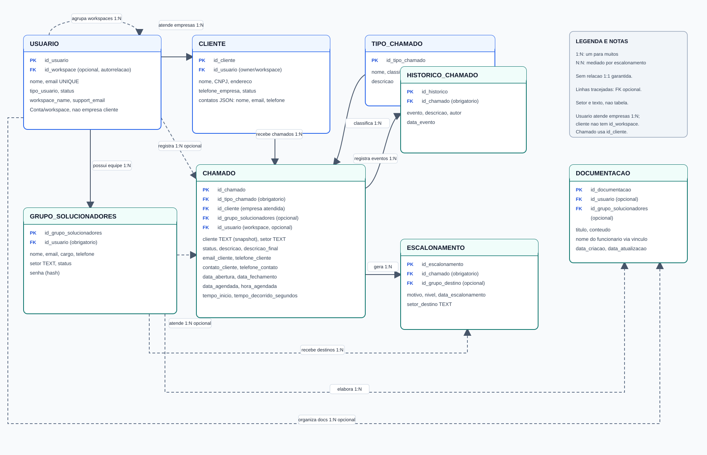

# HelpTI — Como Rodar o Projeto

Guia direto e prático para instalação, execução e testes do **HelpTI**.

> 📖 **Documentação técnica:**
> A modelagem atual do SQLite, com tabelas, relacionamentos e diagrama editável do draw.io, está na [seção 6 deste README](#6-modelagem-do-banco-sqlite). Para arquitetura da solução, regras de negócio e catálogo da API REST, consulte [DOCUMENTACAO_WRAPPER.md](DOCUMENTACAO_WRAPPER.md).

---

## 1. Pré-requisitos

Antes de iniciar, certifique-se de possuir em seu ambiente:
- **Python:** Versão 3.8 ou superior instalada ([python.org](https://www.python.org/downloads/)).
- **Git:** Instalado e configurado no terminal.
- **Navegador Web:** Qualquer navegador moderno (Google Chrome, Microsoft Edge, Mozilla Firefox).
- *(Opcional)* **Docker e Docker Compose:** Caso prefira executar o sistema em containers.

---

## 2. Como Rodar Localmente (Passo a Passo)

### 2.1. Clonar o Repositório
Abra o terminal ou PowerShell e execute:
```bash
git clone https://github.com/Carlos-Eduardo20/HelpTI.git
cd HelpTI
```

### 2.2. Criar e Ativar o Ambiente Virtual

**No Windows (PowerShell):**
```powershell
python -m venv .venv
.\.venv\Scripts\Activate.ps1
```

**No Linux ou macOS:**
```bash
python3 -m venv .venv
source .venv/bin/activate
```

### 2.3. Instalar as Dependências
Com o ambiente virtual ativado, instale os pacotes requeridos:
```bash
pip install -r backend/requirements.txt
```

### 2.4. Iniciar a Aplicação
Execute o arquivo principal na raiz do projeto:
```bash
python app.py
```
> Para executar localmente, o HelpTI usa somente **SQLite** e cria automaticamente `instance/helpti.sqlite3`, sem precisar instalar ou configurar um servidor de banco ([configuração](SETUP_SQLITE.md)). O envio de códigos por e-mail pode usar o Zoho Mail (`smtp.zoho.com`, porta 587 ou 465).

---

## 3. Modos de Inicialização (Demonstração vs. Novo Workspace)

Ao executar `python app.py`, o sistema apresentará uma pergunta interativa no terminal:

```text
Deseja iniciar com a conta de teste HelpTI? [S/N]:
```

### Opção [S] — Modo de Teste / Demonstração (Recomendado)
- Responda **`S`** e pressione Enter.
- O sistema iniciará utilizando o banco local (SQLite por padrão), pré-configurado com a conta administradora **HelpTI**, tipos de chamado e setor de suporte padrão.
- **Acesse no navegador:** [http://127.0.0.1:5000/](http://127.0.0.1:5000/)
- **Credenciais de Teste:**
  - **E-mail:** `test@helpiti.com`
  - **Senha:** `HelpTI2026!!`

### Opção [N] — Novo Workspace / Empresa Própria
- Responda **`N`** e pressione Enter.
- O sistema iniciará com uma base limpa para criar a empresa e a conta administradora principal.
- **Acesse a tela de cadastro:** [http://127.0.0.1:5000/frontend/pages/account.html](http://127.0.0.1:5000/frontend/pages/account.html)

---

## 4. Como Executar com Docker e Docker Compose

Caso possua o Docker instalado e prefira executar em ambiente isolado de containers:

```bash
docker compose up --build
```

A aplicação será compilada e inicializada em: [http://localhost:5000](http://localhost:5000)

Para interromper a execução:
```bash
docker compose down
```

### Hospedagem na Render

O projeto não gerencia certificado SSL, domínio ou registros DNS. Configure o domínio e os registros DNS no Registro.br e associe o domínio personalizado ao serviço na Render, que fornecerá e renovará o certificado HTTPS.

O sistema usa SQLite e o sistema de arquivos da Render é temporário. Para manter clientes, setores, equipe e chamados após reinicializações:

1. No serviço, abra **Disks** e adicione um disco persistente (disponível em serviços pagos), montado em `/var/data`.
2. Configure `DB_SQLITE_PATH=/var/data/helpti.sqlite3`.
3. Configure `HELPTI_DEMO_MODE=false` e `HELPTI_HTTPS_ONLY=true`.
4. Remova variáveis antigas `DB_TYPE`, `DB_HOST`, `DB_PORT`, `DB_NAME`, `DB_USER` e `DB_PASSWORD`.
5. Mantenha uma única instância do serviço: um disco persistente da Render só pode ser usado por uma instância.

O arquivo [render.yaml](render.yaml) já descreve essa configuração para novos serviços Render Blueprint. Para serviços existentes, configure o disco e as variáveis no Dashboard e faça um novo deploy. Dados que já foram perdidos no armazenamento temporário não podem ser recuperados. Se o serviço ainda usava MySQL, exporte seus dados antes de removê-lo: a aplicação não converte esse banco automaticamente.

---

## 5. Como Rodar os Testes Automatizados

O sistema conta com uma suíte de testes unitários e de integração abrangente (verificação de rotas, integridade de dados, regras de negócio do Projeto 3/DeskOps e documentações técnicas).

Para rodar todos os testes automatizados do projeto:
```bash
python -m unittest backend.tests.test_multitenancy backend.tests.test_deskops_project3 backend.tests.test_ticket_email backend.tests.test_admin_db backend.tests.test_pc_explorer
```
Os testes usam arquivos SQLite temporários isolados e os removem ao terminar.

---

## 6. Modelagem do banco SQLite

O SQLite do HelpTI possui oito tabelas no schema atual. O diagrama abaixo usa os relacionamentos definidos em `backend/schema.sql`; linhas contínuas são chaves estrangeiras. O setor é armazenado como texto, sem tabela `setor`.

[](docs/sqlite-model.svg)

O arquivo [editável no draw.io](docs/sqlite-model.drawio) pode ser aberto em [app.diagrams.net](https://app.diagrams.net/) usando **File → Open From → Device**. Os campos do desenho são os principais identificadores; a lista completa está em [`backend/schema.sql`](backend/schema.sql).

### Tabelas

| Tabela | Finalidade | Chaves e campos de destaque |
| --- | --- | --- |
| `usuario` | Workspaces e cadastros de empresas clientes | `id_usuario` (PK), `id_workspace` (FK opcional para `usuario`), `tipo_usuario`, `nome`, `email`, `status` |
| `cliente` | Contatos vinculados a uma empresa cliente | `id_cliente` (PK), `id_usuario` (FK obrigatória para `usuario`), `id_workspace` (FK opcional para `usuario`), `nome`, `email`, `telefone` |
| `tipo_chamado` | Categorias de chamados | `id_tipo_chamado` (PK), `nome`, `classificacao` |
| `grupo_solucionadores` | Funcionários e administradores do workspace | `id_grupo_solucionadores` (PK), `id_usuario` (FK obrigatória), `nome`, `email`, `setor` (TEXT), `status` |
| `chamado` | Chamados e seus dados de atendimento | `id_chamado` (PK), `id_tipo_chamado` (FK obrigatória), `id_grupo_solucionadores` e `id_usuario` (FKs opcionais), `cliente` (TEXT), `setor` (TEXT), `status`, `descricao` |
| `historico_chamado` | Eventos e alterações de cada chamado | `id_historico` (PK), `id_chamado` (FK obrigatória), `evento`, `descricao`, `autor` |
| `escalonamento` | Transferências de chamados | `id_escalonamento` (PK), `id_chamado` (FK obrigatória), `id_grupo_destino` (FK opcional), `motivo`, `setor_destino` (TEXT) |
| `documentacao` | Artigos e procedimentos técnicos | `id_documentacao` (PK), `id_usuario` e `id_grupo_solucionadores` (FKs opcionais), `titulo`, `conteudo` |

### Relacionamentos e cardinalidades

O verbo no meio de cada relação descreve a ação entre as tabelas. A cardinalidade representa o schema SQLite, incluindo quando uma FK pode ser nula.

| Cardinalidade | Relação | Como é implementada |
| --- | --- | --- |
| 1:N | `usuario` **agrupa** `usuario` | `usuario.id_workspace` referencia o workspace pai; a FK é opcional. |
| 1:N | `usuario` **mantém** `cliente` | `cliente.id_usuario` obrigatório aponta para a empresa cliente. |
| 1:N | `usuario` **organiza por workspace** `cliente` | `cliente.id_workspace` é uma FK opcional para o workspace. |
| 1:N | `usuario` **possui** `grupo_solucionadores` | `grupo_solucionadores.id_usuario` é obrigatório. |
| 1:N | `tipo_chamado` **classifica** `chamado` | Cada chamado tem um tipo obrigatório. |
| 1:N | `grupo_solucionadores` **atende** `chamado` | `chamado.id_grupo_solucionadores` é opcional: um chamado pode estar sem responsável. |
| 1:N | `usuario` **registra** `chamado` | `chamado.id_usuario` é opcional. |
| 1:N | `chamado` **registra** `historico_chamado` | Cada evento de histórico pertence a um chamado; excluir o chamado apaga seu histórico. |
| 1:N | `chamado` **gera** `escalonamento` | Cada escalonamento pertence a um chamado. |
| 1:N | `grupo_solucionadores` **recebe** `escalonamento` | `escalonamento.id_grupo_destino` é opcional. |
| 1:N | `usuario` **organiza** `documentacao` | `documentacao.id_usuario` é opcional. |
| 1:N | `grupo_solucionadores` **elabora** `documentacao` | `documentacao.id_grupo_solucionadores` é opcional. |
| 1:1 | Nenhuma relação 1:1 garantida pelo schema atual | Nenhuma FK tem restrição `UNIQUE`; portanto, não há 1:1 assegurada pelo banco. |
| N:N | `chamado` **é escalonado para** `grupo_solucionadores` | Relação lógica mediada por `escalonamento`, que registra o chamado, o destino e os dados da transferência. |

**Limites importantes:** `chamado.cliente` guarda o nome do cliente como texto; não há FK de `chamado` para `cliente` ou `usuario`. Assim, o vínculo entre chamado e cliente não é validado pelo banco. Do mesmo modo, `setor` e `setor_destino` são campos de texto, não entidades relacionadas por FK.


Para executar especificamente a suíte de testes do Projeto 3 (DeskOps):
```bash
python -m unittest backend/tests/test_deskops_project3.py
```

---

## 7. Principais URLs de Acesso

Com a aplicação em execução na porta `5000`:

| Funcionalidade / Módulo | URL no Navegador |
| --- | --- |
| **Painel de Chamados (DeskOps)** | `http://127.0.0.1:5000/frontend/pages/chamados.html` |
| **Dashboard Operacional** | `http://127.0.0.1:5000/frontend/pages/dashboard.html` |
| **Login do Sistema** | `http://127.0.0.1:5000/frontend/pages/login.html` |
| **Cadastro de Novo Administrador** | `http://127.0.0.1:5000/frontend/pages/account.html` |
| **Educação e Visualização 3D** | `http://127.0.0.1:5000/frontend/pages/educacao.html` |
| **Endpoint de Métricas DeskOps** | `http://127.0.0.1:5000/api/chamados/metricas` |
| **Verificação de Saúde da API** | `http://127.0.0.1:5000/api/health` |

---

## 8. Documentação Completa do Projeto

Para consultar o detalhamento de:
- Arquitetura de software e diagrama de componentes
- Justificativa técnica do atributo `setor` (sem tabela própria no modelo conceitual)
- Regras de negócio DeskOps (MTTR médio, SLA, permissões de cliente vs. técnico, autor no histórico)
- Catálogo exaustivo de endpoints da API REST

A modelagem SQLite atual está na [seção 6 deste README](#6-modelagem-do-banco-sqlite). Para os demais tópicos, consulte **[DOCUMENTACAO_WRAPPER.md](DOCUMENTACAO_WRAPPER.md)**.
